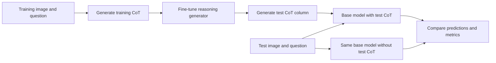
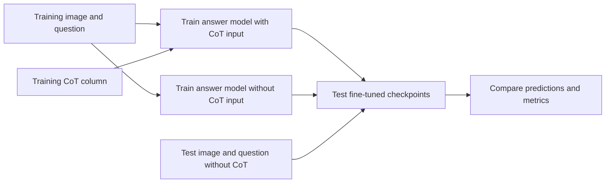

# Medical Visual Question Answering

**Two complementary experiments: test-time reasoning with base models, and fine-tuned answer models evaluated without test-time reasoning.**

Medical VQA research on English SLAKE-derived **Abdomen, Brain/Face, and Neck** subsets. The notebooks cover reasoning generation, LoRA fine-tuning, and open/closed question evaluation on Kaggle and Colab.

[Arup Saha](https://github.com/arups330) · [Hugging Face checkpoints](https://huggingface.co/Arup330) · [Notebook launch directory](docs/launch.md) · [Reproduction](docs/reproduction.md)

## Dataset preparation

The inspected data are grouped by **language → body region → modality → original split → question type**. The experiments focus on CT images for Abdomen, Brain/Face (`Brain_Face`), and Neck. Original train, validation, and test assignments are retained; each split has `open.csv` and `closed.csv`.

See [dataset preparation](docs/dataset_preparation.md) for verified counts and the audit command. The original splitting program is not present in the GitHub notebooks; the documented criteria were checked against the original local metadata archive and exported CSVs. Raw data and images are not uploaded here.

## Pipeline A — Test CoT conditioning of base models

1. Generate CoT for training questions using a vision-language model.
2. Fine-tune a reasoning generator with generated **CoT as its assistant target**.
3. Use the reasoning generator to populate a test-data `CoT` column.
4. Evaluate **base/instruction model checkpoints**, once with the test CoT included and once with an empty CoT input.



**Important:** the saved CoT-generation prompts include the ground-truth answer. This makes the resulting test-CoT branch **answer-conditioned**, not a blind image-and-question evaluation. Also, the saved Neck generator currently selects base Llama; see the [code trace](docs/workflows.md) for this and other differences between intended stages and saved configurations.

| Stage | Notebooks |
|---|---|
| Generate reasoning data | [Reasoning generation](notebooks/reasoning) |
| Train reasoning generators | [Mixed open/closed reasoning-target training](notebooks/training/reasoning_generators/mixed) |
| Evaluate base models with/without test CoT | [Closed questions](notebooks/evaluation/base_models/closed) · [Open questions](notebooks/evaluation/base_models/open) |

## Pipeline B — Fine-tuned answer-model comparison

1. Fine-tune dataset-specific answer models with image, question, and training CoT as inputs.
2. Fine-tune comparison answer models without CoT input.
3. Evaluate both sets of **fine-tuned checkpoints** using the same image-and-question prompt, without a test CoT column.



| Stage | Notebooks |
|---|---|
| Fine-tune answer models | [Closed questions](notebooks/training/closed) · [Open questions](notebooks/training/open) |
| Evaluate fine-tuned models | [Closed evaluator](notebooks/evaluation/closed/evaluate_all_models.ipynb) · [Open evaluator](notebooks/evaluation/open/evaluate_all_models.ipynb) |

Pipeline B uses five model families: Lingshu-7B, MedGemma-4B, Qwen2.5-VL-7B, Qwen3-VL-8B, and Llama-11B. The full grid is 3 regions × 5 model families × 2 training conditions, separately for open and closed questions. Pipeline A has a different registry, including Gemma4-E4B in the inspected evaluators; do not assume both pipelines use an identical model list.

## Open and run

Use [the launch directory](docs/launch.md). Each notebook keeps its **original platform**: Colab opens the GitHub notebook, while Kaggle imports a copy into its editor. Original published Kaggle URLs are not stored in the exports. Configure data, credentials, and GPU before running; clicking a button does not run cells.

Saved inputs, execution counts, outputs, tables, and figures remain in the notebooks. You can inspect them on GitHub without executing GPU workloads. [Historical text reports](results/recorded) are exported from the original Git snapshot, not recomputed results.

## Continuing your work

You can update the working notebooks in place from Kaggle or Colab. The original 31 runs remain accessible in the [immutable research snapshot](docs/snapshots.md). CI checks working notebook structure and credentials while verifying original evidence against the pinned Git commit; it no longer rejects ordinary new evaluation outputs.

For an existing connection, configure the **exact destination path** listed in the [catalog](docs/notebooks.md). In particular, Pipeline B's existing evaluator paths are unchanged:

```text
notebooks/evaluation/closed/evaluate_all_models.ipynb
notebooks/evaluation/open/evaluate_all_models.ipynb
```

See [the update guide](docs/updating_notebooks.md) for saving completed runs, retaining outputs, and publishing new experiments.

## Repository structure

```text
notebooks/
  reasoning/                         # Pipeline A: train/test CoT generation
  training/reasoning_generators/mixed # Pipeline A: CoT-target generator training
  evaluation/base_models/{open,closed} # Pipeline A: test-CoT vs no-test-CoT
  training/{open,closed}/             # Pipeline B: answer-target adapter training
  evaluation/{open,closed}/           # Pipeline B: fine-tuned checkpoint comparison
  manifest.json                      # Provenance, original platform, workflow mapping
docs/                                # Methods, data audit, setup, launch and update guides
results/recorded/                    # Immutable-snapshot text reports
scripts/                             # Data audit, report export, repository checks
tests/                               # CPU-only tooling tests
```

Lowercase descriptive paths follow conventions used by [Hugging Face TRL](https://github.com/huggingface/trl), [Unsloth notebooks](https://github.com/unslothai/notebooks), and [PyTorch Lightning](https://github.com/Lightning-AI/pytorch-lightning). Open and closed question types are explicit wherever a notebook handles only one type; reasoning generators that train on both remain labeled `mixed`.

## Local checks

```bash
python scripts/validate_repository.py
python -m unittest discover -s tests -v
```

These checks do not perform training, inference, or scientific score verification. Read [experiment caveats](docs/experiments.md), [the code-level workflow trace](docs/workflows.md), and [data and licensing](docs/data_and_licensing.md) before interpreting or redistributing results. The associated manuscript is in preparation; no publication or clinical validation is claimed.
