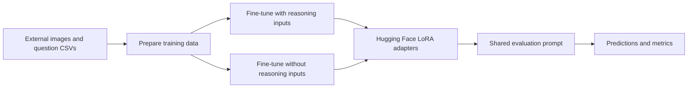

# Medical Visual Question Answering

**Comparing fine-tuned vision-language models trained with and without chain-of-thought inputs.**

Research notebooks for medical image question answering on BrainFace, Neck, and Abdomen subsets of an English SLAKE-derived dataset. The project covers reasoning-data generation, parameter-efficient fine-tuning, and evaluation of closed Yes/No and open-ended answers.

**Author:** [Arup Saha](https://github.com/arups330) · **Model artifacts:** [Arup330 on Hugging Face](https://huggingface.co/Arup330)

## Start here

| Goal | Entry point |
|---|---|
| Inspect closed-question predictions and metrics | [Closed-question evaluation](notebooks/evaluation/closed/evaluate_all_models.ipynb) |
| Inspect open-ended answers and metrics | [Open-question evaluation](notebooks/evaluation/open/evaluate_all_models.ipynb) |
| Train dataset-specific adapters | [Training notebooks](notebooks/training) |
| Explore reasoning-data generation | [Reasoning notebooks](notebooks/reasoning) |
| Find every notebook and its original name | [Notebook catalog](docs/notebooks.md) |
| Run an experiment on Kaggle or Colab | [Reproduction guide](docs/reproduction.md) |
| Understand what the saved results do and do not show | [Experiment notes](docs/experiments.md) |

## Research scope

- **Models:** Lingshu-7B, MedGemma-4B, Qwen2.5-VL-7B, Qwen3-VL-8B, and Llama-3.2-11B-Vision.
- **Training:** dataset-specific LoRA adapters using Unsloth; selected workflows use 4-bit model loading and gradient checkpointing.
- **Comparison:** checkpoints trained with reasoning inputs versus checkpoints trained without them. The main evaluation notebooks use a shared image-and-question prompt.
- **Closed answers:** accuracy, precision, recall, and F1, including macro, weighted, and per-class reporting.
- **Open answers:** inspect the notebook's normalization and metric functions, including BLEU, ROUGE-L, and BERTScore. These metrics do not establish clinical correctness.

The default all-model evaluators cover **3 datasets × 5 model families × 2 training conditions = 30 evaluations per question type**. That describes the configured experiment grid, not a claim that every saved notebook contains a complete, verified run.

## Workflow



## Quick start

### View the saved work

Open a notebook on GitHub to see its code and **saved outputs**, including tables and embedded visualizations. You do not need a GPU, dataset access, or a Hugging Face token to read the committed outputs. If GitHub's notebook renderer is temporarily unavailable, download the `.ipynb` and open it in Jupyter, Kaggle, or Colab.

Selected text reports extracted from existing outputs are also available under [results/recorded](results/recorded). They are historical records, **not newly executed benchmarks**.

### Reproduce an evaluation

1. Import the [closed](notebooks/evaluation/closed/evaluate_all_models.ipynb) or [open](notebooks/evaluation/open/evaluate_all_models.ipynb) evaluator into Kaggle.
2. Enable a CUDA GPU and Internet. Attach the dataset input referenced in the notebook (`arups330/slackdataset`); access is managed outside this repository.
3. Add `HF_TOKEN` to Kaggle Secrets and enable it for the notebook. Accept any base-model access terms through your own Hugging Face account.
4. Run the installation cell in a fresh session. Check dataset paths, question type, exact model repository names, and checkpoint revisions before loading models.
5. Start with `MAX_ROWS_PER_DATASET = 1`, one dataset, and one model. Smoke-test output is not a final benchmark.
6. Set `MAX_ROWS_PER_DATASET = None` for a full run. Preserve predictions and their metadata along with the printed summary.

See [reproduction](docs/reproduction.md) for input schemas, output paths, GPU constraints, and resume settings.

### Check repository integrity locally

```bash
git clone https://github.com/arups330/ElitLab_MED_VQA.git
cd ElitLab_MED_VQA
python scripts/validate_repository.py
```

The checker uses the Python standard library. It verifies all migration hashes and saved output counts, notebook structure, local Markdown links, and common credential patterns. It does **not** train models or verify scientific scores. CI runs the same checks; it does not execute GPU workloads.

## Repository layout

```text
notebooks/
  reasoning/                 # Reasoning-data generation
  training/{closed,open}/    # Dataset-specific fine-tuning
  evaluation/{closed,open}/  # Main evaluators and saved subset snapshots
  archive/                  # Earlier experiments retained with outputs
  manifest.json             # Original paths, content hashes, output fingerprints
docs/                       # Setup, methods, caveats, and full notebook catalog
results/recorded/            # Selected reports extracted from saved outputs
scripts/                    # Integrity checks and report extraction
.github/workflows/          # CPU-only repository validation
```

## Interpreting the experiments

CoT here refers to a **training-input condition**. Supplying reasoning during training does not mean the model independently generates equivalent reasoning at inference. Generated reasoning may use ground-truth answers; this is an important limitation when interpreting comparisons.

The saved BrainFace subset notebook currently selects Abdomen in its configuration while retaining BrainFace outputs. The historical record is preserved as-is and clearly labeled in [experiment notes](docs/experiments.md). Do not attribute those outputs to the current configuration without a fresh run. Small test sets, metric handling of invalid answers, and mutable adapter names also limit comparisons.

## Data, model access, and licensing

Raw medical images, datasets, and model weights are not bundled here. Obtain them from their original providers and follow their access conditions. This is research software, not a clinical diagnostic system. See [data and licensing](docs/data_and_licensing.md) before redistributing artifacts.

## Contributing

See [CONTRIBUTING.md](CONTRIBUTING.md). Keep historical notebooks and outputs intact; put new runs in separately named notebooks and record the environment and checkpoint revisions. The [migration record](docs/migration.md) maps every original file to its organized location.
